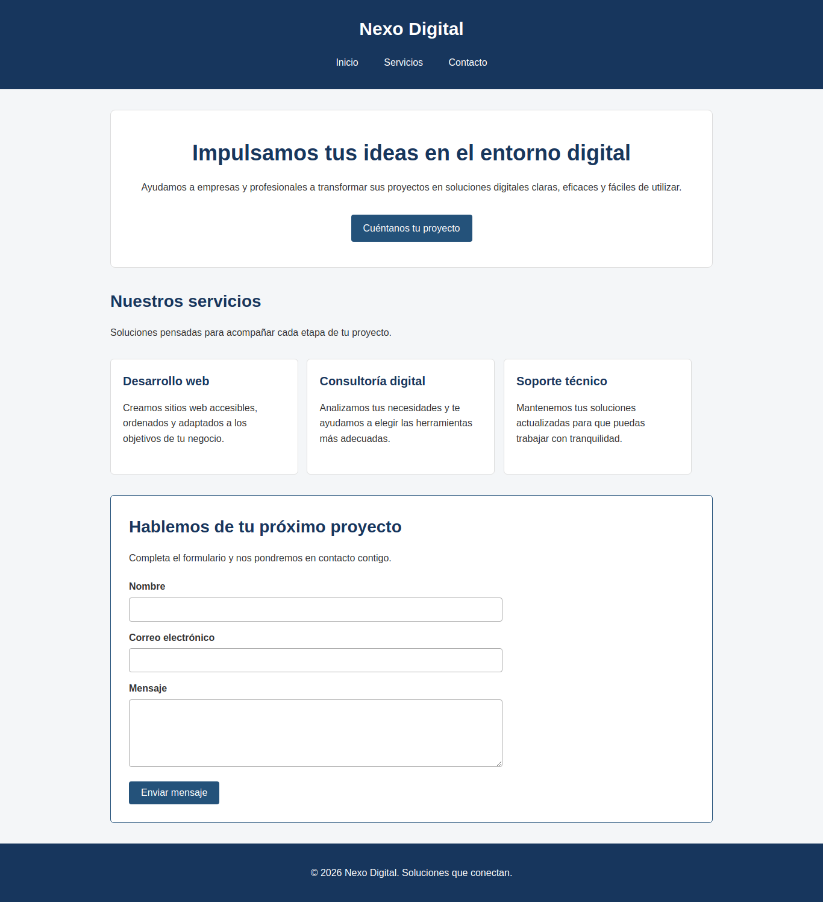
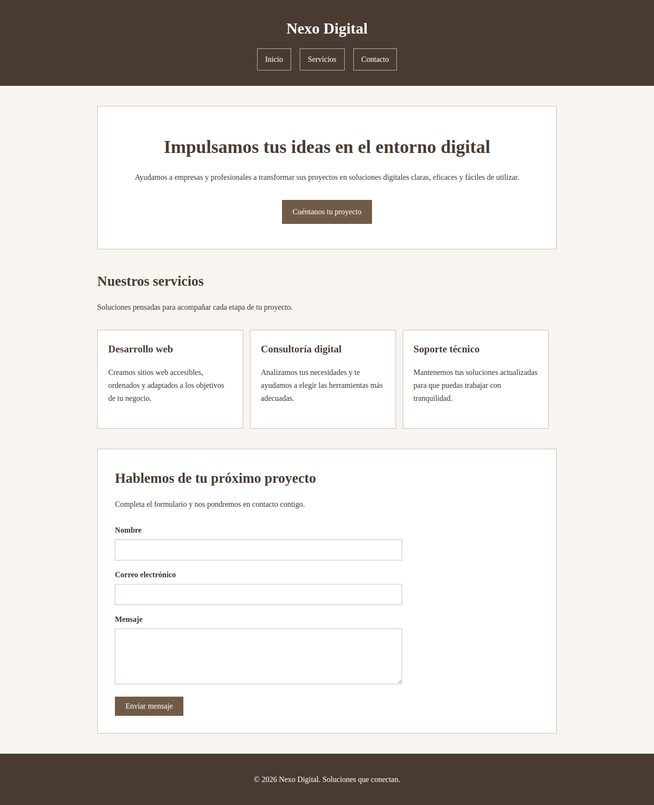

# Práctica evaluable 01 · Una web, dos identidades visuales

📚 **Material didáctico | CFGS Desarrollo de Aplicaciones Multiplataforma**

**Curso:** 1.º DAM  
**Módulo:** Lenguajes de Marcas y Sistemas de Gestión de Información  
**Profesor y autor:** Christian Bihurriet  
**Centro educativo:** CESUR

Repositorio de material docente elaborado para la primera práctica evaluable de HTML5 y CSS3 del módulo de Lenguajes de Marcas y Sistemas de Gestión de Información.

Esta actividad propone completar dos hojas de estilos CSS a partir de requisitos visuales concretos, aplicarlas sobre una misma estructura HTML y comprobar cómo puede modificarse la identidad visual de una página sin alterar su contenido.

## 1. Introducción

Nexo Digital necesita presentar la misma página con dos identidades: una corporativa y otra elegante. La estructura y el contenido serán siempre los mismos; únicamente cambiará la hoja CSS vinculada.

## 2. Objetivos de aprendizaje

- Diferenciar la estructura HTML de la presentación CSS.
- Localizar elementos mediante selectores de etiqueta y de clase.
- Vincular y alternar hojas de estilos externas.
- Aplicar color, tipografía, bordes y espaciado a partir de requisitos concretos.
- Consultar documentación técnica para identificar las propiedades necesarias.

## 3. Material proporcionado

- `index.html`: estructura y contenido completos, todavía sin clases de presentación ni hoja CSS vinculada.
- `corporativo.css`: selectores vacíos para crear la identidad tecnológica.
- `elegante.css`: los mismos selectores vacíos para crear la identidad de consultora.
- `imagenes/`: capturas reales de los dos resultados terminados.

## 4. Instrucciones de realización

1. Inspecciona los tres archivos y reconoce las secciones de la página.
2. Identifica los selectores definidos en ambas hojas CSS.
3. Vincula `corporativo.css` desde el `head` de `index.html`.
4. Incorpora al HTML las clases `.contenedor`, `.marca`, `.presentacion`, `.tarjeta`, `.contacto`, `.campo` y `.boton` siguiendo las correspondencias indicadas a continuación.
5. Completa el estilo corporativo consultando tu guía de HTML5 y CSS3.
6. Compara el resultado con la captura corporativa.
7. Completa `elegante.css` con la segunda tabla de requisitos.
8. Alterna entre los dos estilos modificando únicamente el nombre del archivo en el atributo `href`.
9. Realiza las comprobaciones finales antes de entregar.

No cambies el contenido, la estructura ni las clases para pasar de un diseño a otro.

### Correspondencia entre las clases y el HTML

Añade las clases a estos elementos. No es necesario crear elementos nuevos:

- La clase `.contenedor` corresponde al `div` situado dentro de la cabecera. Es el elemento que contiene el nombre de la empresa y la navegación.
- La clase `.marca` corresponde al párrafo que contiene el texto «Nexo Digital».
- La clase `.presentacion` corresponde a la primera sección del contenido principal, cuyo título es «Impulsamos tus ideas en el entorno digital».
- La clase `.tarjeta` corresponde a cada uno de los tres artículos de la sección de servicios. Debes añadir la misma clase a los tres artículos.
- La clase `.contacto` corresponde a la sección identificada como `contacto`, que contiene el formulario.
- La clase `.campo` corresponde a los dos elementos `input` y al elemento `textarea` del formulario. Debes añadirla a los tres campos.
- La clase `.boton` se utiliza dos veces: en el enlace «Cuéntanos tu proyecto» y en el botón «Enviar mensaje».

Los selectores escritos con nombres de etiquetas, como `body`, `h1`, `header`, `section` o `footer`, funcionan directamente y no requieren añadir ninguna clase.

## 5. Requisitos del estilo corporativo

| Selector | Resultado visual y valores que debes utilizar |
|---|---|
| `body` | Sin margen exterior; texto `#333333`; fondo `#f4f6f8`; tipografía Arial con alternativa genérica sans-serif; tamaño 16 px e interlineado 1,6. |
| `h1` | Margen superior 0, laterales 0 e inferior 15 px; color `#17365d`; tamaño 36 px. |
| `h2` | Margen superior 0, laterales 0 e inferior 10 px; color `#17365d`; tamaño 28 px. |
| `h3` | Margen superior 0, laterales 0 e inferior 8 px; color `#17365d`; tamaño 20 px. |
| `header` | Espaciado interior vertical de 24 px y horizontal de 0; texto blanco y fondo `#17365d`. |
| `.contenedor` | Anchura del 90 %, máximo de 1000 px, centrado horizontalmente y texto centrado. |
| `.marca` | Sin margen superior ni lateral y 12 px de margen inferior; tamaño 30 px y negrita. |
| `nav a` | Mostrar como bloque en línea; margen vertical 0 y horizontal 5 px; espaciado interior vertical 7 px y horizontal 14 px; texto blanco, radio de borde 4 px y sin subrayado. |
| `nav a:hover` | Fondo `#24527a`. |
| `main` | Anchura del 90 %, máximo de 1000 px y margen vertical 34 px con centrado horizontal. |
| `section` | Margen inferior de 34 px. |
| `.presentacion` | Espaciado interior vertical 42 px y horizontal 50 px; borde sólido `#dddddd` de 1 px; radio 8 px; fondo blanco y texto centrado. |
| `.tarjeta` | Bloque en línea con anchura del 27 % y altura de 150 px; margen superior 14 px, derecho 1 % y los demás a 0; espaciado interior 20 px; borde sólido `#dddddd` de 1 px; radio 6 px y fondo blanco. |
| `.contacto` | Espaciado interior 30 px; borde sólido `#24527a` de 1 px; radio 6 px y fondo blanco. |
| `form` | Anchura máxima de 620 px y margen superior de 22 px. |
| `label` | Mostrar en bloque; margen superior 14 px, inferior 5 px y laterales 0; texto en negrita. |
| `.campo` | Anchura del 100 %; espaciado interior 10 px; borde sólido `#aaaaaa` de 1 px; radio 4 px; incluir borde y relleno dentro de la anchura; tipografía Arial con alternativa sans-serif y tamaño 16 px. |
| `.boton` | Bloque en línea; margen superior 16 px; espaciado interior vertical 10 px y horizontal 20 px; texto blanco; sin borde; radio 4 px; fondo `#24527a`; tipografía Arial con alternativa sans-serif y tamaño 16 px; sin subrayado y cursor de mano. |
| `.boton:hover` | Fondo `#17365d`. |
| `footer` | Espaciado interior 20 px; texto blanco; fondo `#17365d` y texto centrado. |

## 6. Requisitos del estilo elegante

| Selector | Resultado visual y valores que debes utilizar |
|---|---|
| `body` | Sin margen exterior; texto `#333333`; fondo `#f8f5f0`; tipografía Georgia con alternativa genérica serif; tamaño 16 px e interlineado 1,7. |
| `h1` | Margen superior 0, laterales 0 e inferior 18 px; color `#493b32`; tamaño 38 px. |
| `h2` | Margen superior 0, laterales 0 e inferior 12 px; color `#493b32`; tamaño 29 px. |
| `h3` | Margen superior 0, laterales 0 e inferior 10 px; color `#493b32`; tamaño 21 px. |
| `header` | Espaciado interior vertical de 32 px y horizontal de 0; texto blanco y fondo `#493b32`. |
| `.contenedor` | Anchura del 88 %, máximo de 960 px, centrado horizontalmente y texto centrado. |
| `.marca` | Sin margen superior ni lateral y 15 px de margen inferior; tamaño 32 px y negrita. |
| `nav a` | Mostrar como bloque en línea; margen vertical 0 y horizontal 7 px; espaciado interior vertical 8 px y horizontal 16 px; texto blanco; borde sólido `#c9bba8` de 1 px y sin subrayado. |
| `nav a:hover` | Fondo `#705b48`. |
| `main` | Anchura del 88 %, máximo de 960 px y margen vertical 42 px con centrado horizontal. |
| `section` | Margen inferior de 42 px. |
| `.presentacion` | Espaciado interior vertical 52 px y horizontal 60 px; borde sólido `#c9bba8` de 1 px; fondo blanco y texto centrado. |
| `.tarjeta` | Bloque en línea con anchura del 27 % y altura de 160 px; margen superior 18 px, derecho 1 % y los demás a 0; espaciado interior 22 px; borde sólido `#c9bba8` de 1 px y fondo blanco. |
| `.contacto` | Espaciado interior 36 px; borde sólido `#c9bba8` de 1 px; fondo blanco. |
| `form` | Anchura máxima de 600 px y margen superior de 26 px. |
| `label` | Mostrar en bloque; margen superior 16 px, inferior 6 px y laterales 0; texto en negrita. |
| `.campo` | Anchura del 100 %; espaciado interior 12 px; borde sólido `#c9bba8` de 1 px; radio 0; incluir borde y relleno dentro de la anchura; tipografía Georgia con alternativa serif y tamaño 16 px. |
| `.boton` | Bloque en línea; margen superior 18 px; espaciado interior vertical 11 px y horizontal 22 px; texto blanco; sin borde ni radio; fondo `#705b48`; tipografía Georgia con alternativa serif y tamaño 16 px; sin subrayado y cursor de mano. |
| `.boton:hover` | Fondo `#493b32`. |
| `footer` | Espaciado interior 24 px; texto blanco; fondo `#493b32` y texto centrado. |

## 7. Resultado visual esperado

Las siguientes imágenes son capturas reales de la página completa, obtenidas a 1366 × 768 píxeles desde el mismo HTML terminado y alternando únicamente la hoja CSS vinculada.

### Identidad corporativa

### Identidad elegante

## 8. Criterios de evaluación

| Criterio | Puntos | Qué se comprobará |
|---|---:|---|
| Vinculación correcta de CSS | 1 | La hoja activa está enlazada correctamente desde el HTML. |
| Incorporación de clases HTML | 2 | Las siete clases se aplican a los elementos adecuados sin alterar la estructura. |
| Estilo corporativo | 2 | Se cumplen los valores de la tabla corporativa. |
| Estilo elegante | 2 | Se cumplen los valores de la tabla elegante. |
| Alternancia de estilos | 1 | Basta cambiar el `href`; no se modifican estructura, contenido ni clases. |
| Requisitos y calidad del código | 1 | No hay errores de sintaxis y el código está ordenado. |
| Defensa práctica y comprensión | 1 | El alumno explica la relación entre selectores, propiedades y elementos, y justifica o modifica una propiedad utilizada en la práctica. |

No se evaluará la creatividad artística.

## 9. Entrega de la práctica

La práctica se realizará de forma individual y se entregará exclusivamente mediante Microsoft Teams.

Una vez completados todos los requisitos:

1. Comprueba que la página funciona correctamente con ambos estilos.
2. Verifica que puedes alternar entre `corporativo.css` y `elegante.css` modificando únicamente la hoja de estilos vinculada.
3. Guarda todos los cambios realizados.
4. Comprime la carpeta completa del proyecto en un archivo `.zip`.
5. Entrega el archivo ZIP en la tarea correspondiente de Microsoft Teams.

**Nombre del archivo:** `Practica01_Nombre_Apellido.zip`

### Importante

- Debes entregar los archivos HTML y CSS modificados.
- No entregues únicamente capturas de pantalla.
- Comprueba que los archivos funcionan correctamente antes de realizar la entrega.
- La práctica podrá incluir una breve defensa individual en la que tendrás que explicar o modificar alguna de las propiedades utilizadas.

## 10. Comprobaciones finales

- [ ] El HTML se abre y todos los enlaces internos funcionan.
- [ ] Las clases están aplicadas a los elementos correctos.
- [ ] El estilo corporativo funciona y coincide con sus requisitos.
- [ ] El estilo elegante funciona y coincide con sus requisitos.
- [ ] No hay errores de sintaxis HTML o CSS.
- [ ] Puedo alternar los estilos cambiando únicamente el `href`.
- [ ] El resultado se corresponde con las capturas de referencia.

## 11. Preguntas de reflexión

1. ¿Qué diferencia existe entre un selector por etiqueta y uno por clase?
2. ¿Por qué podemos utilizar dos hojas de estilos diferentes sin modificar las clases HTML?
3. ¿Qué ventajas tiene reutilizar una hoja CSS en varios proyectos?

## 12. Sobre este repositorio

Este proyecto forma parte de una colección de recursos educativos desarrollados por **Christian Bihurriet** para sus clases del módulo de **Lenguajes de Marcas y Sistemas de Gestión de Información** en el Ciclo Formativo de Grado Superior en Desarrollo de Aplicaciones Multiplataforma, impartido en **CESUR**.

Este repositorio contiene una práctica evaluable de HTML5 y CSS3 destinada al alumnado de 1.º DAM. El código y los requisitos priorizan la claridad didáctica, la comprensión de los fundamentos y la aplicación práctica.
